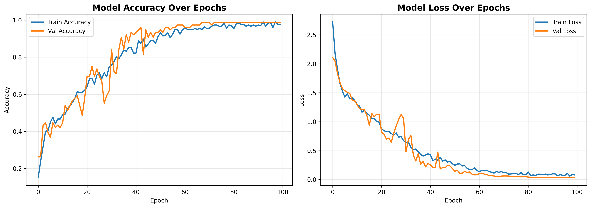
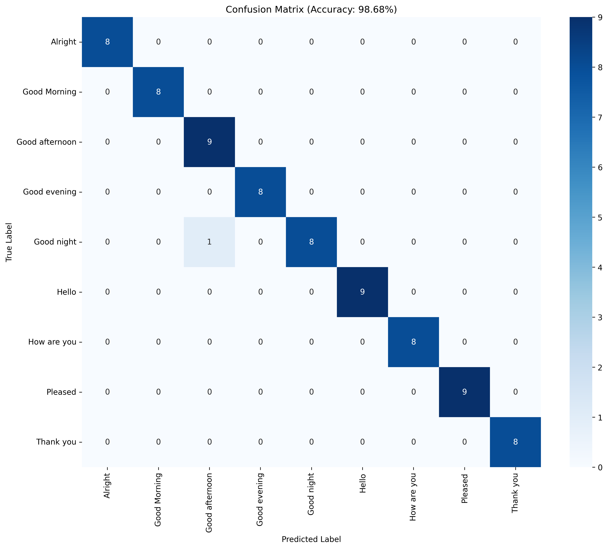
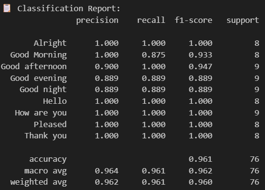

# ✋ SignAI — Real-Time Indian Sign Language Recognition & Translation

<div align="center">


### Making everyday communication more accessible through lightweight computer vision and sign-language AI

**SignAI** is an AI-powered Indian Sign Language (ISL) recognition and transcription project designed to help signers communicate with people who do not know sign language. It combines webcam-based landmark extraction, temporal gesture recognition, fingerspelling, sentence reconstruction, text output, speech, and browser-based video-call integration.

[Repository](https://github.com/Code-r4Life/SignAI) · [Teammate's Real-Time Translator](https://github.com/satya-py/Sign-Language-Translation-Real-Time-)

</div>

---

## 📌 Table of Contents

- [Overview](#-overview)
- [The Problem](#-the-problem)
- [Project Journey](#-project-journey)
- [Key Features](#-key-features)
- [System Architecture](#-system-architecture)
- [Computer Vision and Landmark Processing](#-computer-vision-and-landmark-processing)
- [Recognition Models](#-recognition-models)
- [Fingerspelling](#-fingerspelling)
- [Sentence Reconstruction](#-sentence-reconstruction)
- [Custom Sign Collection and Retraining](#-custom-sign-collection-and-retraining)
- [Real-Time Video-Call Extension](#-real-time-video-call-extension)
- [Technology Stack](#-technology-stack)
- [Repository Structure](#-repository-structure)
- [Getting Started](#-getting-started)
- [Training and Evaluation](#-training-and-evaluation)
- [Data, Model, and Evaluation Notes](#-data-model-and-evaluation-notes)
- [Limitations and Responsible Use](#-limitations-and-responsible-use)
- [Future Scope](#-future-scope)
- [Dataset, Credits, and References](#-dataset-credits-and-references)
- [Team](#-team)
- [Contact](#-contact)

---

## 📖 Overview

SignAI explores a practical approach to real-time Indian Sign Language recognition. Rather than depending only on alphabet-by-alphabet fingerspelling, the project focuses on recognizing complete signs and words, assembling predictions into readable English, and making the result available where communication actually takes place.

The project combines several connected components:

1. **Visual landmark extraction** — MediaPipe Holistic detects hand and body landmarks from camera frames.
2. **Temporal sign recognition** — neural models classify sequences of landmark features.
3. **Fingerspelling** — a separate lightweight MLP recognizes alphabet and digit classes for names and terms outside the word vocabulary.
4. **Sentence reconstruction** — recognized signs are converted into readable English using predefined cases and grammar, with an optional LLM-assisted fallback in the relevant pipeline.
5. **Accessible output** — translations can be displayed as text and spoken aloud.
6. **Video-call integration** — a Chrome extension connects the live translation workflow with meeting chat interfaces.

The project has been explored through multiple model iterations. The early experiments, the GCN–BiLSTM notebook/inference path, and the separate SignNet pipeline in the linked real-time translator are related parts of the development story, but they are **not the same model**. The exact capabilities available depend on which code path and checkpoint are being run.

> **Primary use case:** accessible communication, including a healthcare scenario where a deaf patient may need to communicate symptoms such as a headache, fever, sore throat, stomach ache, or difficulty breathing to a doctor.

SignAI is a research and engineering prototype. It is not a certified interpreter or a clinically validated medical communication system.

---

## 🎯 The Problem

Communication between a signer and a person who does not know sign language can be difficult when a qualified interpreter is not immediately available. A practical assistive tool should aim to do more than classify static hand shapes.

SignAI explores four related challenges:

- **Sign-level recognition:** recognizing complete gestures or words rather than relying exclusively on individual letters.
- **Temporal understanding:** using movement over a sequence of frames, not only a single image.
- **Meaning reconstruction:** turning a sequence of predicted signs into a more readable sentence.
- **Accessible interaction:** presenting the result as text and speech, and integrating it into existing communication tools.

### Why this approach?

- Uses a standard webcam; no gloves or specialized depth camera are required by the described landmark pipeline.
- Uses compact landmark features instead of feeding every raw video frame into a large vision-language model.
- Separates word recognition and fingerspelling so each can serve a different purpose.
- Treats data collection, preprocessing, inference, language reconstruction, and delivery as separate components that can be tested and improved.

---

## 🧭 Project Journey

The project evolved through experimentation, testing, and changes to the training strategy.

### 1. Initial experiments with INCLUDE-50

The first iteration focused on a small subset of greeting-related ISL signs. The team used videos from the INCLUDE dataset, extracted frames, applied augmentations, detected landmarks with MediaPipe, and trained a BiLSTM classifier with a softmax output over the selected classes.

The initial subset contained nine classes. This smaller scope made experimentation possible with limited compute and helped establish the first end-to-end recognition baseline.

### 2. Discovering the training-to-webcam gap

A central challenge was that results on clean, pre-recorded clips did not translate reliably to a live webcam. The recording conditions, signer, camera framing, background, and timing can differ between a dataset and a real application.

This highlighted an important lesson: a model's offline score alone does not establish robust live performance.

### 3. Collecting examples through the intended capture workflow

The team then began recording signs through a webcam and saving the extracted feature sequences as NumPy `.npy` files. These recordings were used to train models on examples collected under conditions closer to the intended inference setup.

This was an attempt to reduce capture-domain mismatch. It does not remove all domain shift, especially for unseen signers or different cameras, but it makes the data-collection process more representative of the product's intended use.

### 4. Moving toward healthcare communication

The project direction expanded from greetings toward a more focused healthcare scenario. The intended vocabulary included symptom-related signs such as headache, fever, sore throat, stomach ache, and trouble breathing. The goal was to explore a tool that could help patients share basic information during in-person or remote consultations.

### 5. Exploring custom sign training

A web-based training workflow was developed so users could record examples of a sign, extract its features, and update/retrain a model without manually building a training dataset outside the application. The intention is to make vocabulary expansion more accessible.

As with any retraining process, the updated model still needs evaluation: adding a new class should not silently degrade predictions for existing signs.

### 6. Adding fingerspelling and communication tools

A separate MLP-based fingerspelling path was developed for 26 letters and 10 digits. The project also includes a browser-extension direction for speaking translations and inserting completed text into supported video-call chat boxes.

---

## ⚡ Key Features

| Feature | Description |
|---|---|
| 🎥 Webcam-based recognition | Captures live frames through a standard camera. |
| ✋ Landmark extraction | Uses MediaPipe Holistic to obtain hand and pose keypoints. |
| 🧠 Temporal sign models | Experiments with BiLSTM, GCN–BiLSTM, and a separate CNN–Transformer SignNet pipeline. |
| 🔤 Fingerspelling | Uses a separate MLP for alphabet and digit recognition. |
| 🧩 Sentence reconstruction | Converts predicted sign/gloss sequences into readable English with grammar and optional LLM assistance in the relevant pipeline. |
| 🔁 Custom data collection | Records examples and stores landmark feature sequences for training. |
| 📊 Model evaluation | Includes training histories, a confusion matrix, and a classification report where present in the repository. |
| 🔊 Speech output | Uses text-to-speech in the browser-extension workflow. |
| 🌐 Browser integration | Can insert completed translations into compatible video-call chat interfaces through the extension. |
| 🔒 Local inference option | The documented extension sends frames to its local backend rather than a remote video-processing service. |

---

## 🏗️ System Architecture

At a high level, the application consists of a visual recognition pipeline, a language reconstruction step, and one or more output interfaces.

```text
                 ┌──────────────────────┐
                 │ Webcam / Video Input │
                 └──────────┬───────────┘
                            │
                            ▼
                 ┌──────────────────────┐
                 │ MediaPipe Holistic   │
                 │ Hands + Pose         │
                 └──────────┬───────────┘
                            │
                            ▼
                 ┌──────────────────────┐
                 │ Landmark Processing  │
                 │ Normalize / Sequence │
                 └──────────┬───────────┘
                            │
                ┌───────────┴────────────┐
                ▼                        ▼
      ┌──────────────────┐    ┌──────────────────┐
      │ Word/Sign Model  │    │ Fingerspelling   │
      │ Temporal Model   │    │ MLP Classifier   │
      └─────────┬────────┘    └─────────┬────────┘
                │                       │
                └───────────┬───────────┘
                            ▼
                 ┌──────────────────────┐
                 │ Sign / Token Sequence│
                 └──────────┬───────────┘
                            ▼
                 ┌──────────────────────┐
                 │ Sentence Construction│
                 │ Grammar / LLM fallback│
                 └──────────┬───────────┘
                            │
              ┌─────────────┼─────────────┐
              ▼             ▼             ▼
           Text UI      Text-to-Speech  Call Chat
                                        Integration
```

This diagram represents the **overall project concept**. The exact inference route differs by implementation: for example, the uploaded GCN–BiLSTM script performs windowed classification, while the linked SignNet application includes a continuous sign-spotting and sentence-assembly pipeline.

---

## ✋ Computer Vision and Landmark Processing

### MediaPipe Holistic

The landmark-based pipeline uses MediaPipe Holistic to extract:

- **Left hand:** 21 landmarks, each represented by (x,y,z).
- **Right hand:** 21 landmarks, each represented by (x,y,z).
- **Pose:** 33 landmarks, each represented by (x,y,z) and a visibility value.

The resulting feature count is:

```text
Left hand:   21 × 3 =  63
Right hand:  21 × 3 =  63
Pose:        33 × 4 = 132
                         ---
Total:                 258 features per frame
```

A sequence of 60 frames therefore has the flat feature shape:

```text
(60, 258)
```

### Relative normalization

The GCN–BiLSTM implementation normalizes coordinates relative to a wrist-origin chosen from the detected hands and scales coordinates using shoulder width. The intention is to make features less sensitive to the signer's position and apparent size in the camera.

The normalization strategy must remain consistent between training and inference. Missing or unreliable landmarks can still produce poor features, so normalization is not a substitute for robust detection or representative training data.

### Temporal preprocessing

The documented model path uses a maximum sequence length of 60 frames. Short sequences are padded, and longer sequences are truncated. Training experiments also explored:

- Small image rotations.
- Horizontal flipping.
- Temporal augmentation, such as changing playback speed.
- Landmark-level augmentation.
- Sequence preparation and normalization.

Augmentation choices must preserve the meaning and handedness of a sign. Not every geometric transformation is appropriate for every sign.

---

## 🧠 Recognition Models

The repository represents an evolving set of approaches, not one architecture used by every component.

### A. Early BiLSTM baseline

The initial experimentation used INCLUDE videos and a BiLSTM over extracted MediaPipe landmarks. A softmax layer produced probabilities for the nine selected greeting classes.

This helped establish the early pipeline but exposed the difference between offline dataset evaluation and live webcam conditions.

### B. GCN–BiLSTM model

The repository includes a GCN–BiLSTM implementation in the notebook-aligned inference path, including `live_detection.py` and the Flask backend's GCN helpers.

#### Graph representation

The skeleton is represented as a graph of 75 joints:

| Component | Nodes | Feature values |
|---|---:|---:|
| Left hand | 21 | 3 per node |
| Right hand | 21 | 3 per node |
| Pose | 33 | 4 per node |
| **Total** | **75** | **258 flattened values per frame** |

The adjacency matrix defines edges for finger bones, palm structure, the pose skeleton, and wrist links between hand and pose landmarks. Self-loops are added, then the adjacency matrix is symmetrically degree-normalized.

#### Model flow

```text
Input sequence: (60, 300)
          │
          ▼
Reshape to: (60, 75 joints, 4 features)
          │
          ▼
GCN layer: 64 output features
          │
          ▼
GCN layer: 128 output features
          │
          ▼
Flatten each frame + masking
          │
          ▼
Bidirectional LSTM: 256 units
          │
          ▼
Bidirectional LSTM: 128 units
          │
          ▼
Dense layers: 256 → 128
          │
          ▼
Softmax over configured classes
```

The graph layers model spatial relationships between connected landmarks, while the BiLSTM layers model temporal relationships across the sequence. Dropout and batch normalization are included in the model.

The model's flat input is 300 values per frame because (75 	imes 4 = 300). The source landmark representation has 258 values per frame; conversion adds a fourth feature channel to each hand node, padded with zeros for those hand features.

### C. SignNet in the linked real-time translator

The linked [Real-Time ISL Translator](https://github.com/satya-py/Sign-Language-Translation-Real-Time-) documents a separate SignNet model: a depthwise 1D CNN followed by a small Transformer encoder over body-relative keypoints, with approximately 0.82 million parameters. That pipeline includes a sign spotter and continuous sentence construction.

This is a related implementation used for real-time translation, but **it should not be confused with the GCN–BiLSTM model in this repository**. The linked repository's README explicitly distinguishes its trained SignNet checkpoint from a GCN–BiLSTM architecture.

---

## 🔤 Fingerspelling

Word-level vocabularies cannot cover every name, address, abbreviation, or unfamiliar term. The project therefore also explores fingerspelling as a complementary channel.

The described fingerspelling classifier:

- Uses webcam-collected landmark feature files.
- Uses a lightweight multilayer perceptron (MLP) with dense/linear layers.
- Classifies 36 classes: 26 alphabet letters and 10 digits.
- Is designed for low-latency inference without relying on a large vision-language model.

The recognized sequence can be used to spell names or other terms that are not represented by the word-level model.

The repository also contains `Action Detection Refined.ipynb`, a notebook associated with the fingerspelling work. Model files and evaluation claims should be interpreted in relation to the data and training pipeline that produced each checkpoint; performance from one fingerspelling model should not automatically be attributed to another.

---

## 🧩 Sentence Reconstruction

Sign classification and natural-language generation are separate tasks.

A recognizer can produce a sequence of glosses or tokens, but that sequence may not follow English grammar. SignAI therefore explores sentence reconstruction after recognition.

The documented approaches across the project include:

1. **Predefined sentence cases** for known combinations.
2. **Slot/grammar-based construction** to turn common sign sequences into readable English.
3. **Optional LLM assistance** when configured, for cases where a generated sentence may be useful.

Example:

```text
Recognized glosses:
I  PAIN  HEAD  2  DAY

Constructed English:
I have a headache for 2 days.
```

The example demonstrates the intended transformation; it does not imply that every arbitrary sign sequence will be translated with perfect accuracy.

When an LLM is used, it should operate on the recognized sign sequence and relevant context—not be treated as proof that the upstream sign predictions are correct. For sensitive use cases such as healthcare, the signer and recipient should be able to review or confirm the generated meaning.

---

## 🔁 Custom Sign Collection and Retraining

A key project idea is to make vocabulary expansion easier for users.

The intended workflow is:

```text
Select or add a sign
        ↓
Record multiple webcam examples
        ↓
Extract MediaPipe landmarks
        ↓
Save feature sequences (.npy)
        ↓
Prepare the dataset and labels
        ↓
Train / retrain the compatible model
        ↓
Evaluate the updated model
        ↓
Export and load the checkpoint for inference
```

Your described web workflow records several examples—five takes per sign in the linked translator workflow—and enables model updates without manually creating the training data outside the application.

**Important:** a retraining workflow is not automatically equivalent to true incremental or continual learning. Unless the training implementation explicitly updates weights incrementally, adding a sign may retrain the model using a dataset of old and new examples. Always preserve examples of existing classes and validate the new checkpoint before replacing the previous one.

---

## 🌐 Real-Time Video-Call Extension

The linked `Real-Time-ISL` submodule contains a Chrome extension and local Flask backend designed to bring the translation workflow into browser-based calls.

The linked implementation documents integrations or test-bench scenarios for services such as:

- Google Meet
- Zoom
- Microsoft Teams
- Discord
- Slack
- Jitsi
- Webex
- Whereby
- Skype
- BigBlueButton
- Custom WebRTC applications

Actual behavior depends on site permissions, the current call interface, and the chat editor's DOM structure. The list should not be interpreted as a guarantee that every website version will always work.

### How the extension workflow operates

1. The user selects the call tab and grants the required permissions.
2. An offscreen document keeps the camera capture active after the popup closes.
3. The extension sends batches of JPEG frames to the local backend.
4. The backend performs sign recognition and sentence construction.
5. A completed sentence is spoken using the browser's Web Speech API.
6. The extension can insert the sentence into the call's chat composer and send it.

The extension's README documents a tiered strategy for finding chat inputs: first use an already-focused element, then selectors for known platforms, and finally a heuristic search for editable message composers. The injection script is described as running when text is being sent, rather than permanently observing the call page.

### Local backend endpoints documented by the extension

| Method | Endpoint | Purpose |
|---|---|---|
| `GET` | `/api/health` | Reports model path, vocabulary, and open sessions. |
| `POST` | `/api/session` | Starts a browser translation session. |
| `POST` | `/api/chunk` | Processes a batch of frames and returns glosses, sentence, completion state, and confidence. |
| `POST` | `/api/finish` | Finishes the current sentence immediately. |
| `POST` | `/api/reset` | Clears the accumulated words. |
| `POST` | `/api/close` | Ends the session and releases the tracker. |

These endpoint details describe the linked extension backend; they are not the same as the Flask API routes in the main repository.

### Privacy and local processing

The linked extension README states that its backend runs locally and that webcam frames are sent to `127.0.0.1`, not to a remote video-processing backend. If an optional LLM provider is configured for sentence reconstruction, the privacy characteristics of that provider must also be considered. Avoid sending sensitive medical information to external services unless the user understands and has approved that behavior.

### Resource requirements

MediaPipe tracking can use substantial memory. The linked extension README warns that XNNPACK initialization may abort the process when the system cannot allocate enough contiguous memory. It recommends avoiding simultaneous execution of two recognition backends and optionally using a lower MediaPipe model-complexity setting.

For browser-extension operation, Chrome 116 or newer is documented as a requirement because the extension uses the offscreen document API.

---

## 🛠️ Technology Stack

| Area | Technologies | Role |
|---|---|---|
| Computer vision | OpenCV, MediaPipe Holistic | Webcam/video handling and landmark extraction |
| Data processing | Python, NumPy, scikit-learn | Feature preparation, utilities, and evaluation |
| Deep learning | TensorFlow, Keras | Training and inference for the documented neural models |
| Temporal recognition | BiLSTM, LSTM, Transformer (by pipeline) | Modeling gesture sequences |
| Spatial recognition | Graph Convolutional Network (GCN) | Modeling relationships between skeletal landmarks in the GCN–BiLSTM path |
| Fingerspelling | MLP / dense layers | Alphabet and digit classification |
| Language generation | Grammar/slot rules, optional LLM, LangChain in relevant paths | Sentence reconstruction |
| Frontend | React, Vite, Tailwind CSS, Framer Motion, Axios | User interface and backend requests |
| Backend | Flask, Flask-CORS | Inference API for the main repository |
| Browser integration | Chrome Extension APIs, Web Speech API | Video-call capture, text insertion, and speech |
| Dataset | INCLUDE / Indian Sign Language dataset | Starting point for sign-recognition experiments |

Some components belong to different branches or stages of the project. For example, the current root Flask backend's model helpers use TensorFlow/Keras and GCN–BiLSTM, while the linked real-time translator's README documents a PyTorch-based SignNet inference path. Install dependencies for the specific component you intend to run.

---

## 📂 Repository Structure

The following is a high-level map of the repository and its main visible components. Some datasets and trained artifacts may need to be downloaded or generated locally.

```text
SignAI/
│
├── backend/
│   ├── app.py                         # Flask API, landmark processing and GCN–BiLSTM inference
│   ├── requirements.txt               # Backend-specific Python dependencies
│   └── runtime.txt                    # Runtime configuration
│
├── frontend/
│   ├── src/
│   │   ├── components/                # Reusable UI components
│   │   ├── pages/
│   │   │   ├── Home.jsx               # Landing page
│   │   │   ├── About.jsx              # Project information
│   │   │   ├── Detection.jsx           # Sign detection interface
│   │   │   └── Signs.jsx                # Supported signs information
│   │   ├── App.jsx
│   │   └── main.jsx
│   ├── package.json
│   ├── vite.config.js
│   └── tailwind.config.js
│
├── outputs/
│   ├── classification_report.png      # Classification metrics visualization
│   ├── confusion_matrix.png           # Confusion matrix
│   ├── training_history.png            # Training and validation curves
│   ├── processed_landmarks.pkl         # Class metadata / processed data artifact, if present
│   └── model checkpoints               # Exact checkpoint names depend on the current run
│
├── MP_Data/                            # Collected/preprocessed examples, if present
├── Logs/                               # Logs, if present
├── Real-Time-ISL/                      # Git submodule: teammate's real-time translator
├── ISL_transcription.ipynb             # Recognition/training experiments
├── Action Detection Refined.ipynb      # Fingerspelling/action-model notebook
├── live_detection.py                   # Standalone webcam GCN–BiLSTM inference
├── requirements.txt                    # Root Python environment snapshot
├── ISL_Report.pdf                      # Project report
├── INCLUDE ISL.pdf                     # Dataset/reference document
└── README.md
```

> Repository contents evolve. Check the actual files and available model artifacts before running a command. A notebook, checkpoint, or dataset that is not present locally must be downloaded or generated first.

---

## 🚀 Getting Started

### Prerequisites

- Python compatible with the selected backend dependencies.
- Node.js and npm for the React frontend.
- A working webcam.
- A supported operating system and sufficient memory for MediaPipe and TensorFlow.
- The required trained checkpoint and class metadata for the recognition path being run.
- A Gemini API key only if the configured sentence-reconstruction path uses Gemini.

> **Dependency note:** the root and backend dependency files have different version pins. Use a virtual environment and install dependencies for the component you are running. TensorFlow, NumPy, OpenCV, MediaPipe and protobuf versions can be sensitive to compatibility constraints.

### 1. Clone the repository

```bash
git clone https://github.com/Code-r4Life/SignAI.git
cd SignAI
```

The real-time translator is configured as a Git submodule. To initialize it:

```bash
git submodule update --init --recursive
```

If the submodule is unavailable or you only need the main repository, you can work on the main project components separately.

### 2. Set up the Python backend

Create and activate a virtual environment from the repository root.

**Windows (PowerShell):**

```powershell
python -m venv .venv
.\.venv\Scripts\Activate.ps1
pip install -r backend/requirements.txt
```

**macOS / Linux:**

```bash
python3 -m venv .venv
source .venv/bin/activate
pip install -r backend/requirements.txt
```

Check the backend configuration in `backend/app.py`. The code supports environment variables such as:

```env
MODEL_PATH=outputs/best_isl_gcn_model.keras
DATA_PATH=outputs/processed_landmarks.pkl
DATASET_PATH=path/to/your/dataset
GEMINI_API_KEY=your_api_key_here
GEMINI_MODEL=gemini-2.5-flash
CONFIDENCE_THRESHOLD=0.4
```

Use the exact paths for your local files. Do not commit real API keys or secrets to GitHub.

Start the Flask backend:

```bash
python backend/app.py
```

The actual routes and startup behavior should be checked in `backend/app.py`; the main repository backend and extension backend use separate APIs.

### 3. Set up the frontend

Open a second terminal:

```bash
cd frontend
npm install
npm run dev
```

Vite prints the local development URL in the terminal. Open that address in your browser and allow camera permission when prompted by the application.

To create a production build:

```bash
npm run build
```

### 4. Run the standalone GCN–BiLSTM webcam script

The root-level `live_detection.py` is a separate OpenCV webcam inference script. It expects the model and class metadata paths configured near the top of the file:

```python
MODEL_PATH = "outputs/best_isl_gcn_model.keras"
PKL_PATH = "outputs/processed_landmarks.pkl"
```

Verify that both files exist, that the checkpoint matches the model definition, and that the metadata contains the expected `class_names` before running:

```bash
python live_detection.py
```

The script captures a four-second window, processes up to 60 frames, displays one class prediction and its confidence, then starts the next window. Press **Q** to quit.

This script is not the same as the continuous sign-spotting workflow documented in the `Real-Time-ISL` submodule.

---

## 📊 Training and Evaluation

The repository includes notebook-based model experiments and training/evaluation visualizations.

### Training pipeline

The project history and code describe the following stages:

1. Load labeled videos or webcam-recorded examples.
2. Extract frames and/or collect MediaPipe landmarks.
3. Apply suitable image, temporal, and landmark-level augmentation.
4. Normalize and form fixed-length sequences.
5. Encode labels and prepare train/validation/test partitions.
6. Train the selected architecture.
7. Evaluate on held-out data and inspect class-level errors.
8. Save the model checkpoint and the class metadata required for inference.

### Visual evaluation artifacts

Where available in the repository, these plots provide different views of model behavior.

#### Training history



Training and validation accuracy/loss can help reveal convergence, instability, and possible overfitting. They do not independently prove generalization to new signers.

#### Confusion matrix



A confusion matrix shows which classes are being confused with one another and can help identify classes that need more varied examples.

#### Classification report



The classification report can help inspect class-level precision, recall, and F1-score where the corresponding artifact was generated.

### Evaluation principles

For a meaningful evaluation, keep in mind:

- **Avoid leakage:** near-identical frames from the same recording should not be spread across training and test sets.
- **Separate by signer when possible:** frame-level or clip-level splits can overestimate performance if a signer appears in both training and evaluation sets.
- **Test the real capture path:** evaluate the complete preprocessing and inference pipeline, not only a model on precomputed ideal features.
- **Report misses as well as incorrect predictions:** a system that abstains frequently behaves differently from one that confidently predicts the wrong sign.
- **Evaluate sentence output separately:** sign classification accuracy and sentence-level translation quality are different metrics.

---

## 📏 Data, Model, and Evaluation Notes

### Dataset

The initial recognition experiments used the [INCLUDE Indian Sign Language dataset](https://zenodo.org/records/4010759), credited to AI4Bharat. The project later supplemented the dataset-based approach with webcam-collected landmark examples for the intended live setting.

Dataset assets may not all be included in the Git repository. Large videos and model files may need to be obtained separately, subject to the dataset's license and distribution requirements.

### Do not mix metrics from different pipelines

The linked teammate README reports measurements for its own SignNet live pipeline, including 95.4% first-sign correctness on 1,185 clips across 87 signs and a separate evaluation on the signer's webcam takes. Those are **reported results for that implementation and its evaluation scripts**; they should not be presented as results for the GCN–BiLSTM model in this repository unless that model has been evaluated independently using the same protocol.

Likewise, accuracy from the fingerspelling model must be tied to its own dataset, checkpoint, class definitions, and split strategy.

For reproducible results, record the model checkpoint, dataset version, class vocabulary, signer split, preprocessing configuration, and evaluation command alongside the reported metric.

---

## ⚠️ Limitations and Responsible Use

SignAI is an assistive prototype, and several practical limitations remain.

- **Signer dependence:** signing styles differ between people. A model trained from a limited number of signers may not generalize to people it has never seen.
- **Limited vocabulary:** a classifier can only reliably predict the classes it was trained to recognize. Out-of-vocabulary signs may be missed or misclassified.
- **Visual conditions:** poor lighting, occlusion, camera placement, background clutter, and missing landmarks can reduce recognition quality.
- **Temporal segmentation:** deciding where one sign ends and another begins is difficult. Windowed classification and continuous sign spotting have different failure modes.
- **Language ambiguity:** gloss-to-English reconstruction can change meaning if upstream signs are wrong or if grammar/context is underspecified.
- **LLM reliability:** generated sentences may sound fluent while being inaccurate. The sentence should remain reviewable, particularly in healthcare.
- **Healthcare safety:** do not rely on this prototype as the sole channel for diagnosis, emergency instructions, consent, medication details, or other high-stakes medical decisions. Confirm critical information with the patient and a qualified interpreter or communication professional when needed.
- **Browser compatibility:** meeting sites can alter their chat interfaces and security behavior, requiring selector updates.
- **Runtime resources:** MediaPipe and neural frameworks can require substantial memory. The intended hardware and dependency versions affect startup and latency.

The goal is to support communication—not to replace human interpreters in situations where accuracy, nuance, or safety is essential.

---

## 🔮 Future Scope

Potential directions for further development include:

- Expanding the ISL vocabulary with balanced, signer-diverse training examples.
- Improving continuous sign segmentation and transition/idle detection.
- Evaluating signer-independent generalization and real-world camera robustness.
- Strengthening fingerspelling decoding and language-aware letter commitment.
- Preserving old-class performance during custom vocabulary updates.
- Supporting multilingual output while preserving the meaning of the original sign sequence.
- Improving confidence calibration and adding a clear "please repeat/confirm" path.
- Adding an easy human-interpreter fallback for sensitive conversations.
- Optimizing inference for low-memory devices and mobile deployment.
- Exploring AR interfaces and additional communication platforms.
- Reporting end-to-end latency, sign-level precision/recall, missed-sign rate, and sentence-level quality on reproducible tests.

These are development opportunities, not claims that every feature is already implemented.

---

## 📚 Dataset, Credits, and References

- **INCLUDE / Indian Sign Language dataset — AI4Bharat:** [Zenodo record](https://zenodo.org/records/4010759). Consult the dataset's terms and attribution requirements before redistributing any source files.
- **MediaPipe:** Google’s framework for hand and pose landmark extraction. [Official documentation](https://ai.google.dev/edge/mediapipe/solutions/guide)
- **TensorFlow / Keras:** neural network training and inference. [TensorFlow](https://www.tensorflow.org/)
- **React:** frontend interface. [React](https://react.dev/)
- **Real-Time ISL Translator and browser extension:** [satya-py/Sign-Language-Translation-Real-Time-](https://github.com/satya-py/Sign-Language-Translation-Real-Time-)

The main project includes original experimentation, model code, and application components. Dataset videos, third-party libraries, and the linked submodule retain their respective licenses and ownership.

---

## 👥 Team

**Team Byte_Coders**

- **Shinjan Saha** — Team Lead
- **Satyabrata Das Adhikari**
- **Sayan Sk**

The project material supplied for the hackathon also lists **Soumyadip Manna** and **Srijan Sarkar** as team members. Team composition may differ by project phase or submission; update this section to reflect the contributors to the current repository.

---

## 📬 Contact

Interested in accessibility-focused AI, computer vision, or ML-integrated applications?

- **Email:** [shinjansaha00@gmail.com](mailto:shinjansaha00@gmail.com)
- **LinkedIn:** [Shinjan Saha](https://www.linkedin.com/in/shinjan-saha-1bb744319/)
- **GitHub:** [Code-r4Life](https://github.com/Code-r4Life)

---

<div align="center">

⭐ If you find this project interesting, consider giving the repository a star.

**Building technology that helps people understand one another.**

</div>
