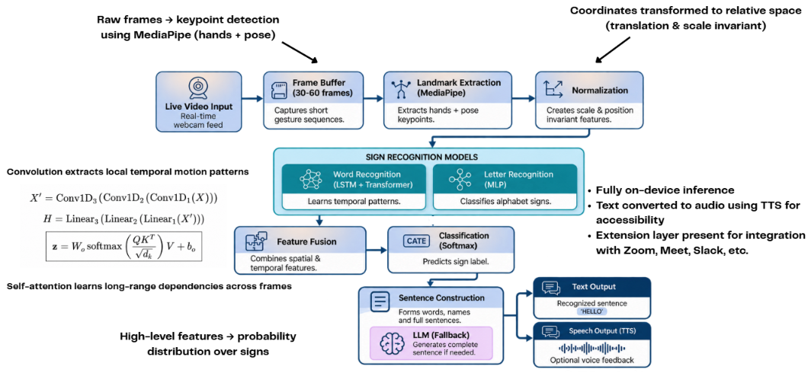
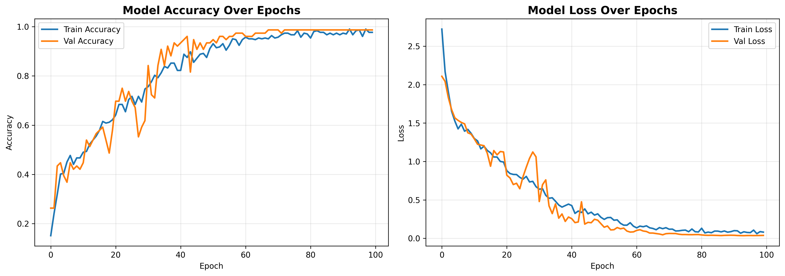
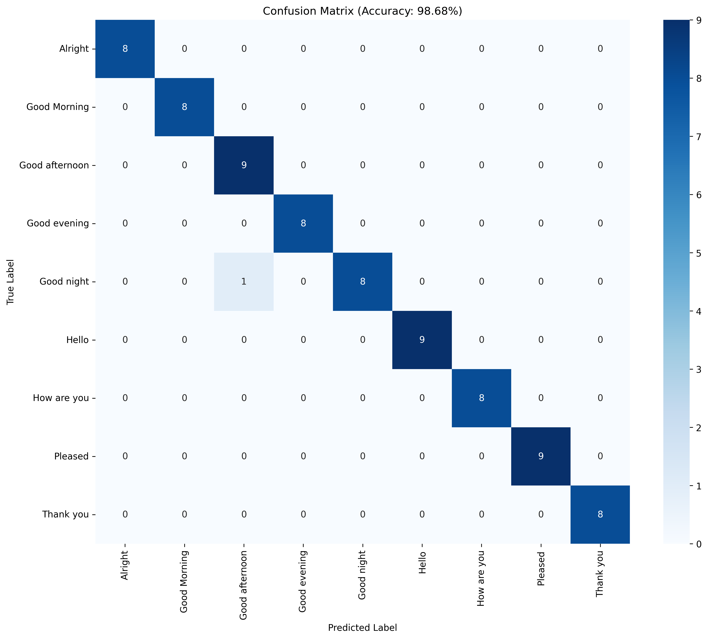
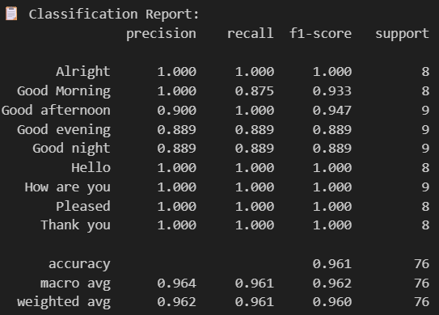

<div align="center">

# ✋ SignAI — Real-Time Indian Sign Language Recognition & Translation


### Making everyday communication more accessible through lightweight computer vision and sign-language AI

**SignAI** is a hackathon project that helps a deaf signer communicate with someone who doesn't know sign language. A webcam reads Indian Sign Language (ISL), landmark-based models recognize the signs, a grammar layer turns them into an English sentence, and the result is shown as text and spoken aloud — even inside a video call.

[🚀 **Live Demo**](https://sign-language-translation-real-time.vercel.app/) · [🎬 **Demo Video**](https://youtu.be/fYINhoBnkyM?si=cxjUjucRxC2j2O7u) · [💻 **Real-Time Translator (submodule)**](https://github.com/satya-py/Sign-Language-Translation-Real-Time-) · [📦 **This Repository**](https://github.com/Code-r4Life/SignAI)

</div>

---

## 📌 Table of Contents

- [TL;DR — What's in This Repo](#-tldr--whats-in-this-repo)
- [Overview](#-overview)
- [The Problem](#-the-problem)
- [Project Journey](#-project-journey)
- [GCN–BiLSTM vs SignNet: What We Learned](#-gcnbilstm-vs-signnet-what-we-learned)
- [System Architecture](#-system-architecture)
- [Landmark Processing](#-landmark-processing)
- [Model A: GCN–BiLSTM (this repo)](#-model-a-gcnbilstm-this-repo)
- [Model B: SignNet (deployed, in the submodule)](#-model-b-signnet-deployed-in-the-submodule)
- [Fingerspelling](#-fingerspelling)
- [Sentence Reconstruction](#-sentence-reconstruction)
- [Custom Sign Collection and Retraining](#-custom-sign-collection-and-retraining)
- [Video-Call Extension](#-video-call-extension)
- [Deployment](#-deployment)
- [Benchmarks](#-benchmarks)
- [Technology Stack](#-technology-stack)
- [Repository Structure](#-repository-structure)
- [Getting Started](#-getting-started)
- [Training and Evaluation](#-training-and-evaluation)
- [Limitations and Responsible Use](#-limitations-and-responsible-use)
- [Future Scope](#-future-scope)
- [Dataset, Credits, and References](#-dataset-credits-and-references)
- [Team](#-team)
- [Contact](#-contact)

---

## 🧾 TL;DR — What's in This Repo

This repository tells the **whole story** of the project, and it contains two recognition approaches. They are different models, and only one of them powers the live app.

| | **GCN–BiLSTM** (this repo) | **SignNet** (`Real-Time-ISL/` submodule) |
|---|---|---|
| **Architecture** | Graph Convolutional Network + stacked BiLSTM (TensorFlow/Keras) | Depthwise 1D CNN + small Transformer encoder (~0.82M params, PyTorch) |
| **Role** | Our first serious architecture; research/baseline path | **The model running in the deployed application** |
| **Offline accuracy** | Strong on held-out dataset clips | Strong on dataset clips *and* webcam takes |
| **Live webcam behaviour** | Did **not** hold up — much weaker than its offline numbers suggested | Held up; no major drift observed |
| **Deployed?** | ❌ No | ✅ Yes — [Vercel](https://sign-language-translation-real-time.vercel.app/) frontend + Azure (Docker) backend |
| **Where to find it** | `ISL_transcription.ipynb`, `live_detection.py`, `backend/app.py` | [`Real-Time-ISL/`](./Real-Time-ISL) |

We keep the GCN–BiLSTM work in the repo on purpose. It documents a real finding of the project: **a good offline score did not translate to a good live webcam experience**, and understanding *why* is what led us to the architecture and data decisions that finally worked.

> 👉 Looking for the working demo? Go to the [live app](https://sign-language-translation-real-time.vercel.app/), watch the [demo video](https://youtu.be/fYINhoBnkyM?si=cxjUjucRxC2j2O7u), or jump to the [`Real-Time-ISL/`](./Real-Time-ISL) submodule.

---

## 📖 Overview

SignAI explores a practical approach to real-time Indian Sign Language recognition. Rather than relying only on alphabet-by-alphabet fingerspelling, the project recognizes complete signs and words, assembles them into readable English, and delivers the result where communication actually happens.

The project combines several connected components:

1. **Landmark extraction** — MediaPipe Holistic detects hand and body landmarks from webcam frames.
2. **Temporal sign recognition** — neural models classify sequences of landmark features.
3. **Fingerspelling** — a lightweight MLP recognizes letters and digits for names and out-of-vocabulary terms.
4. **Sentence reconstruction** — recognized signs become readable English via a slot grammar, with an optional LLM-assisted path.
5. **Accessible output** — text on screen plus text-to-speech.
6. **Video-call integration** — a Chrome extension speaks translations and types them into call chat.

> **Primary use case:** healthcare communication — a deaf patient telling a doctor about a headache, fever, sore throat, stomach ache, or trouble breathing.

SignAI is a research and engineering prototype. It is **not** a certified interpreter or a clinically validated medical communication system.

---

## 🎯 The Problem

Communication between a signer and a person who doesn't know sign language is hard when a qualified interpreter isn't immediately available. A useful assistive tool has to do more than classify static hand shapes. SignAI tackles four related challenges:

- **Sign-level recognition** — recognizing complete gestures, not only letters.
- **Temporal understanding** — using movement across frames, not a single image.
- **Meaning reconstruction** — turning a sequence of signs into a readable sentence.
- **Accessible interaction** — presenting results as text and speech, inside tools people already use.

### Why this approach?

- Standard webcam only — no gloves or depth camera.
- Compact landmark features instead of raw video frames or a large vision-language model.
- Word recognition and fingerspelling are separate channels, each doing what it's good at.
- Capture, preprocessing, inference, language reconstruction, and delivery are independent components that can be tested and improved separately.

---

## 🧭 Project Journey

The project evolved through experimentation, honest testing, and a couple of hard pivots.

### 1. Starting small with INCLUDE

We began with a nine-class subset of greeting signs from the INCLUDE dataset. We extracted frames, applied augmentations, detected landmarks with MediaPipe, and trained a BiLSTM with a softmax head. The small scope fit our compute budget and gave us a first end-to-end baseline.

### 2. Building the GCN–BiLSTM

To exploit the skeleton structure, we built a **GCN–BiLSTM**: graph convolutions model spatial relationships between joints, and BiLSTMs model movement over time. On held-out dataset clips it performed well. This is the model documented in this repository.

### 3. Hitting the training-to-webcam gap

When we moved from clean pre-recorded clips to a live webcam, performance dropped sharply. Signer, camera framing, background, distance, and timing all differ between a dataset and a real application. **Offline accuracy alone did not establish robust live performance** — the central lesson of the project.

### 4. Collecting webcam data ourselves

We built a capture workflow to record signs through the webcam and save the extracted feature sequences as `.npy` files, so training data matched the conditions of live inference more closely. We also moved toward a focused **healthcare vocabulary** (headache, fever, sore throat, stomach ache, trouble breathing, and more).

### 5. Rethinking the model and the features

Working with teammate **Satyabrata Das Adhikari**, we rebuilt the recognition path around a different design — **SignNet**, a depthwise 1D-CNN + Transformer — together with changes to *how the data was represented and trained*:

- **Body-relative features** (origin between the shoulders, scale = shoulder width), so the model stops depending on where the signer sits in the frame.
- **Training on the moving part of each clip**, because dataset clips start and end with the signer standing still while the live app never sends those frames.
- **Mining "movement between signs"** as negative examples, so a hand dropping or rising isn't confidently called a word.
- **Capping class weights**, so a newly taught sign with few takes doesn't outvote everything taught before.
- **A sign spotter** that cuts one sign at a time from a continuous stream.

This version held up on live webcam data, so it became the model behind the deployed app. Shinjan contributed to the architecture design, the experimental thinking, and the custom webcam dataset collection.

### 6. Custom sign training, fingerspelling, and the call extension

We added in-browser custom sign recording and retraining, a fingerspelling channel, a human-interpreter fallback, and a Chrome extension that brings translation into video calls.

### 7. Shipping it

The translator is deployed with the **frontend on Vercel** and the **backend on Azure, containerized with Docker**. For the hackathon, we also produced a [demo video](https://youtu.be/fYINhoBnkyM?si=cxjUjucRxC2j2O7u) (scripted, recorded, and edited by Shinjan).

---

## 🔬 GCN–BiLSTM vs SignNet: What We Learned

We think the failed approach is as valuable as the working one, so here is what the comparison taught us:

1. **An offline metric is a measurement of the dataset, not of the product.** The GCN–BiLSTM scored well on held-out clips but was disappointing on live webcam input.
2. **Representation mattered more than depth.** Moving to body-relative features and training on realistic (moving, in-the-wild) windows did more for live accuracy than architectural complexity.
3. **Collect data the way you'll run inference.** Webcam-recorded takes from the intended capture setup closed much of the domain gap.
4. **Handle "nothing" explicitly.** Without negative examples for in-between motion, classifiers turn idle movement into confident nonsense.
5. **Beware silent regressions when you add vocabulary.** Class weighting directly affects whether old signs keep working after retraining.
6. **Keep the evidence.** We kept both implementations so readers can see what was tried, what failed, and why.

---

## 🏗️ System Architecture

At a high level, the application consists of a visual recognition pipeline, a language reconstruction step, and one or more output interfaces.

```text
                 ┌──────────────────────┐
                 │ Webcam / Video Input │
                 └──────────┬───────────┘
                            │
                            ▼
                 ┌──────────────────────┐
                 │  MediaPipe Holistic  │
                 │     Hands + Pose     │
                 └──────────┬───────────┘
                            │
                            ▼
                 ┌──────────────────────┐
                 │ Landmark Processing  │
                 │ Normalize / Sequence │
                 └──────────┬───────────┘
                            │
                ┌───────────┴────────────┐
                ▼                        ▼
      ┌──────────────────┐    ┌──────────────────┐
      │ Word/Sign Model  │    │  Fingerspelling  │
      │ Temporal Model   │    │  MLP Classifier  │
      └─────────┬────────┘    └─────────┬────────┘
                │                       │
                └───────────┬───────────┘
                            ▼
                 ┌──────────────────────┐
                 │ Sign / Token Sequence│
                 └──────────┬───────────┘
                            ▼
                 ┌──────────────────────┐
                 │ Sentence Construction│
                 │Grammar / LLM fallback│
                 └──────────┬───────────┘
                            │
              ┌─────────────┼─────────────┐
              ▼             ▼             ▼
           Text UI    Text-to-Speech   Call Chat
                                      Integration
```

This is the **overall project concept**. The exact route differs by implementation: the GCN–BiLSTM script in this repo performs windowed classification, while the deployed SignNet application uses a continuous sign spotter and sentence assembly.

### 🖼️ End-to-End Architecture Diagram

The diagram below (designed by Shinjan) shows the full system as deployed: webcam frames and MediaPipe landmark extraction, sign/letter recognition, sentence construction, text output, and speech output.

<div align="center">



</div>

### ☁️ Deployment Topology

```text
   Browser (user's webcam)
        │  frames
        ▼
 ┌──────────────────┐    HTTPS    ┌─────────────────────────────┐
 │ React + Vite UI  │ ──────────► │ Backend (Docker container)  │
 │  hosted on Vercel│             │ on Azure                    │
 └──────────────────┘ ◄────────── │ MediaPipe + SignNet + slots │
                       sentence   └─────────────────────────────┘
```

---

## ✋ Landmark Processing

### MediaPipe Holistic

Both recognition paths start from MediaPipe Holistic landmarks:

- **Left hand:** 21 landmarks × (x, y, z)
- **Right hand:** 21 landmarks × (x, y, z)
- **Pose:** 33 landmarks × (x, y, z, visibility)

```text
Left hand:   21 × 3 =  63
Right hand:  21 × 3 =  63
Pose:        33 × 4 = 132
                         ---
Total:                 258 features per frame
```

A 60-frame sequence has the flat shape `(60, 258)`.

### Normalization

- **GCN–BiLSTM (this repo):** coordinates are normalized relative to a wrist origin chosen from the detected hands, and scaled by shoulder width.
- **SignNet (submodule):** every point is measured from a **body-relative origin between the shoulders**, in units of shoulder width. This change was one of the single biggest contributors to making live recognition work.

Normalization must stay consistent between training and inference, and it does not replace robust landmark detection or representative training data.

### Temporal preprocessing and augmentation

The GCN–BiLSTM path uses a maximum sequence length of 60 frames (padded or truncated). Experiments explored small rotations, horizontal flips, speed changes, and landmark-level augmentation. Augmentations must preserve the meaning and handedness of a sign — not every geometric transform is safe for every sign.

---

## 🧠 Model A: GCN–BiLSTM (this repo)

The GCN–BiLSTM lives in `ISL_transcription.ipynb`, `live_detection.py`, and the GCN helpers in `backend/app.py`.

> ⚠️ **Status:** research/baseline path. It is **not** the model used in the deployed application, because it did not perform well on real webcam data.

### Graph representation

The skeleton is a graph of **75 joints**:

| Component | Nodes | Feature values |
|---|---:|---:|
| Left hand | 21 | 3 per node |
| Right hand | 21 | 3 per node |
| Pose | 33 | 4 per node |
| **Total** | **75** | **258 flattened values per frame** |

The adjacency matrix connects finger bones, palm structure, the pose skeleton, and wrist links between hand and pose landmarks. Self-loops are added and the matrix is symmetrically degree-normalized.

### Model flow

```text
Input sequence: (60, 300)
          │
          ▼
Reshape to: (60, 75 joints, 4 features)
          │
          ▼
GCN layer: 64 output features
          │
          ▼
GCN layer: 128 output features
          │
          ▼
Flatten each frame + masking
          │
          ▼
Bidirectional LSTM: 256 units
          │
          ▼
Bidirectional LSTM: 128 units
          │
          ▼
Dense layers: 256 → 128
          │
          ▼
Softmax over configured classes
```

The model's flat input is 300 values per frame because 75 × 4 = 300. The source landmark representation has 258 values; conversion gives every node four feature channels, with the missing fourth channel of the hand joints zero-padded. Dropout and batch normalization are used.

### Why it struggled live

- Features were less robust to webcam framing and signer position than SignNet's body-relative representation.
- Training windows differed from what the live pipeline actually feeds the model.
- Fixed-window classification has no notion of "no sign happening", so idle or transitional motion could be classified as a word.
- Offline evaluation hid all of this.

---

## ⚡ Model B: SignNet (deployed, in the submodule)

The deployed model lives in the [`Real-Time-ISL/`](./Real-Time-ISL) submodule ([upstream repository](https://github.com/satya-py/Sign-Language-Translation-Real-Time-)).

- **Architecture:** depthwise 1D CNN followed by a small Transformer encoder over body-relative keypoints, about **0.82M parameters**.
- **Vocabulary:** **87 signs** recognized live from a webcam.
- **Sign spotter:** cuts one sign from a continuous stream.
- **Sentence layer:** slot grammar (plus an LLM when a key is configured).
- **Fingerspelling:** letters and digits for names and anything without a sign.
- **Human interpreter fallback** when the machine isn't enough.
- **Teach-it-yourself:** record five takes of a new sign in the browser and retrain in about five minutes.

```text
webcam ──► MediaPipe Holistic ──► 300 numbers a frame
                                      │
                        body-relative features (origin between the
                        shoulders, scale = shoulder width) ──► SignNet
                                      │                    (1D CNN + transformer,
                        sign spotter cuts one sign            0.82M parameters)
                                      │
                             glosses ──► slot grammar (+ LLM optional)
                                      │
                                 "I have a headache for 2 days."
```

The design decisions that mattered most:

- **Body-relative features** — the earlier raw-coordinate model was useless on a webcam.
- **Training on the moving part of a clip** — removes a class of confident nonsense.
- **Mining movement between signs** — in the submodule's measurement, between-sign movement reported as a word dropped from 56% to 14%.
- **Capped class weights** — fixes "the old signs stopped working" after teaching new ones.
- **Test-time augmentation removed** — it sounded right but measured worse (93% vs 96%) and silenced more signs.

Full details, scripts, and re-runnable evaluations are in the submodule's own README.

---

## 🔤 Fingerspelling

Word-level vocabularies can't cover every name, address, or abbreviation, so a fingerspelling channel complements them.

- Uses webcam-collected landmark files (`MP_Data/`).
- Uses a lightweight **MLP** with dense layers — low latency, no large vision-language model.
- The notebook in this repo, `Action Detection Refined.ipynb`, trains the fingerspelling model on 26 letters and 10 digits.
- The translator in the submodule retrains and tunes its own fingerspelling classifier (letters and digits, 37 classes) with evaluation scripts.

Accuracy claims must be tied to the specific dataset, checkpoint, and split that produced them; a number from one fingerspelling model isn't evidence for another. See the [Benchmarks](#-benchmarks) section for what is and isn't claimed.

---

## 🧩 Sentence Reconstruction

Sign classification and sentence generation are separate tasks. A recognizer produces glosses that may not follow English grammar, so SignAI reconstructs sentences afterward:

1. **Predefined sentence cases** for known combinations.
2. **Slot/grammar-based construction** for common sign sequences.
3. **Optional LLM assistance** when configured.

```text
Recognized glosses:
I  PAIN  HEAD  2  DAY

Constructed English:
I have a headache for 2 days.
```

The deployed translator's slot grammar is checked by a test suite of **81 sentence cases** (81/81 exact in the submodule's reported run, with no sign dropped). This shows the intended transformation; it doesn't mean every arbitrary sign sequence will translate perfectly.

An LLM should operate on the recognized sign sequence — it is not evidence that upstream predictions are correct. For healthcare, the signer and recipient should be able to review or confirm the generated meaning.

---

## 🔁 Custom Sign Collection and Retraining

A key idea is making vocabulary expansion easy for users.

```text
Select or add a sign
        ↓
Record multiple webcam examples (five takes in the translator)
        ↓
Extract MediaPipe landmarks
        ↓
Save feature sequences (.npy)
        ↓
Prepare dataset and labels
        ↓
Train / retrain the compatible model
        ↓
Evaluate the updated model
        ↓
Export and load the checkpoint for inference
```

Retraining isn't automatically continual learning: unless weights are updated incrementally, adding a sign retrains on a dataset of old and new examples. Always preserve examples of existing classes and validate a new checkpoint before replacing the previous one. This is exactly why SignNet caps class weights — so a freshly taught sign with few takes doesn't outvote the signs taught before it.

---

## 🌐 Video-Call Extension

The submodule includes a **Chrome extension** and backend that bring translation into browser-based calls. Test-bench scenarios and selectors cover services such as Google Meet, Zoom, Microsoft Teams, Discord, Slack, Jitsi, Webex, Whereby, Skype, BigBlueButton, and custom WebRTC apps. Behavior depends on site permissions, the current call interface, and the chat editor's DOM structure; the list isn't a guarantee for every site version.

### How it works

1. The user selects the call tab and grants permissions.
2. An offscreen document keeps camera capture alive after the popup closes.
3. The extension sends batches of JPEG frames to the backend.
4. The backend performs recognition and sentence construction.
5. The sentence is spoken with the browser's Web Speech API.
6. The extension can insert the sentence into the call's chat composer and send it.

Chrome 116+ is required (offscreen document API). Chat input lookup is tiered: an already-focused element, then selectors for known platforms, then a heuristic search for editable composers.

### Privacy

When run locally, frames are sent to `127.0.0.1`, not a remote video-processing service. In the hosted deployment, frames go to the project's own Azure-hosted backend. If an optional LLM provider is configured for sentence reconstruction, that provider's privacy characteristics also apply — avoid sending sensitive medical information to external services unless users understand and approve it.

---

## ☁️ Deployment

| Layer | Platform | Notes |
|---|---|---|
| **Frontend** | **Vercel** | React + Vite app → **[live demo](https://sign-language-translation-real-time.vercel.app/)** |
| **Backend** | **Azure**, containerized with **Docker** | MediaPipe + SignNet inference and sentence construction |
| **Demo video** | YouTube | **[Watch the demo](https://youtu.be/fYINhoBnkyM?si=cxjUjucRxC2j2O7u)** |

**Memory matters.** MediaPipe builds its tracking graph through XNNPACK, which needs a few hundred megabytes in one contiguous block. When it can't get them it aborts the process instead of raising an error. With PyTorch alongside it, the backend needs roughly **1 GB** to answer its first frame, so small (e.g. 512 MB) instances can start, pass a health check, and then die on the first camera frame. Size the container accordingly.

Step-by-step deployment details are in the submodule's `DEPLOY.md`.

---

## 📊 Benchmarks

All figures below are **reported by the Real-Time-ISL submodule** for **SignNet**, produced by scripts in that repository that can be re-run. They are **not** results for the GCN–BiLSTM in this repo.

| What | Result | How |
|---|---|---|
| First sign correct through the live pipeline | **95.4%** (1,185 clips, 87 signs) | `live/eval_live.py` |
| Signer's own webcam takes, end to end | **96% right, 1% wrong, 3% missed** (272 takes) | `live/eval_live.py` |
| Between-sign movement reported as a word | **14%** (was 56% before enlarging the idle set) | `live/train.py` |
| Sentence construction | **81/81 cases exact, no sign dropped** | `live/test_sentences.py` |
| Fingerspelling letters | **94.6%** on held-out frames | `fingerspell/train_letters.py --split time` |
| Letters that can be committed live | **35 of 37**, 0.35 s each | `fingerspell/tune_letters.py` |
| Speed | ~22 fps desktop, ~14 fps through the browser | — |

### What is deliberately *not* claimed

- Any accuracy for a signer the model has never seen. Sign recognition is signer-dependent; takes from the person who will demo it are worth more than any amount of tuning.
- The accuracy of the notebook's `action.h5` fingerspelling model, because the data it trained on isn't in the repository.
- Any live-webcam accuracy figure for the GCN–BiLSTM. Its offline results are visible in `outputs/`, but our honest finding is that they did not carry over to the webcam.

### Do not mix metrics across pipelines

For reproducibility, record the checkpoint, dataset version, class vocabulary, signer split, preprocessing configuration, and evaluation command next to every reported metric.

---

## 🛠️ Technology Stack

| Area | Technologies | Role |
|---|---|---|
| Computer vision | OpenCV, MediaPipe Holistic | Webcam/video handling and landmark extraction |
| Data processing | Python, NumPy, scikit-learn | Feature preparation, utilities, evaluation |
| Deep learning | TensorFlow/Keras (GCN–BiLSTM), PyTorch (SignNet) | Training and inference |
| Temporal recognition | BiLSTM; 1D CNN + Transformer encoder | Modeling gesture sequences |
| Spatial recognition | Graph Convolutional Network | Skeleton relationships in the GCN–BiLSTM path |
| Fingerspelling | MLP / dense layers | Letter and digit classification |
| Language generation | Slot grammar, optional LLM | Sentence reconstruction |
| Frontend | React, Vite, Tailwind CSS, Framer Motion, Axios | User interface |
| Backend | Flask (this repo), FastAPI (translator) | Inference APIs |
| Browser integration | Chrome Extension APIs, Web Speech API | Call capture, text insertion, speech |
| Deployment | Vercel, Azure, Docker | Hosting frontend and backend |
| Dataset | INCLUDE (AI4Bharat) + webcam-collected data | Training and evaluation |

Components belong to different stages of the project: this repo's Flask helpers use TensorFlow/Keras and the GCN–BiLSTM, while the submodule documents a PyTorch-based SignNet path. Install dependencies for the component you intend to run.

---

## 📂 Repository Structure

```text
SignAI/
│
├── backend/
│   ├── app.py                          # Flask API, landmark processing, GCN–BiLSTM inference
│   ├── requirements.txt                # Backend-specific Python dependencies
│   └── runtime.txt                     # Runtime configuration
│
├── frontend/
│   ├── src/
│   │   ├── components/                 # Reusable UI components
│   │   ├── pages/
│   │   │   ├── Home.jsx                # Landing page
│   │   │   ├── About.jsx               # Project information
│   │   │   ├── Detection.jsx           # Sign detection interface
│   │   │   └── Signs.jsx               # Supported signs information
│   │   ├── App.jsx
│   │   └── main.jsx
│   ├── package.json
│   ├── vite.config.js
│   └── tailwind.config.js
│
├── outputs/
│   ├── classification_report.png       # Classification metrics (GCN–BiLSTM)
│   ├── confusion_matrix.png            # Confusion matrix (GCN–BiLSTM)
│   ├── training_history.png            # Training/validation curves (GCN–BiLSTM)
│   └── Arch.png                        # End-to-end system architecture diagram
│
├── MP_Data/                            # Webcam-collected .npy files for fingerspelling
├── Logs/                               # Logs
├── Real-Time-ISL/                      # ⭐ Git submodule: the deployed SignNet translator
├── ISL_transcription.ipynb             # GCN–BiLSTM recognition/training experiments
├── Action Detection Refined.ipynb      # Trains the fingerspelling model using MP_Data/
├── live_detection.py                   # Standalone webcam GCN–BiLSTM inference
├── requirements.txt                    # Root Python environment snapshot
├── INCLUDE ISL.pdf                     # INCLUDE research paper
└── README.md
```

> Repository contents evolve. Datasets and trained artifacts may need to be downloaded or generated locally.

---

## 🚀 Getting Started

> Just want to try it? Use the **[live demo](https://sign-language-translation-real-time.vercel.app/)** — no install needed.

### Prerequisites

- Python compatible with the selected backend dependencies
- Node.js and npm for the React frontend
- A working webcam
- Enough memory for MediaPipe and TensorFlow/PyTorch (about 1 GB free for the translator backend)
- The trained checkpoint and class metadata for the path you're running
- A Gemini API key only if your sentence-reconstruction path uses Gemini

> **Dependency note:** the root and backend dependency files have different version pins. Use a virtual environment per component. TensorFlow, NumPy, OpenCV, MediaPipe, and protobuf can be version-sensitive.

### 1. Clone the repository (with the submodule)

```bash
git clone --recurse-submodules https://github.com/Code-r4Life/SignAI.git
cd SignAI
```

If you already cloned without submodules:

```bash
git submodule update --init --recursive
```

### 2. Run the deployed translator (recommended)

This is the model behind the live demo. Follow the submodule's own instructions:

```bash
cd Real-Time-ISL
```

Then see [`Real-Time-ISL/README.md`](./Real-Time-ISL/README.md) for install, build, and run steps (Python 3.12, ~1 GB free memory). The backend serves the built frontend, so one process is the whole app at `http://127.0.0.1:8000`.

### 3. Run the GCN–BiLSTM backend (this repo)

**Windows (PowerShell):**

```powershell
python -m venv .venv
.\.venv\Scripts\Activate.ps1
pip install -r backend/requirements.txt
```

**macOS / Linux:**

```bash
python3 -m venv .venv
source .venv/bin/activate
pip install -r backend/requirements.txt
```

Check the configuration in `backend/app.py`. Supported environment variables include:

```env
MODEL_PATH=outputs/best_isl_gcn_model.keras
DATA_PATH=outputs/processed_landmarks.pkl
DATASET_PATH=path/to/your/dataset
GEMINI_API_KEY=your_api_key_here
GEMINI_MODEL=gemini-2.5-flash
CONFIDENCE_THRESHOLD=0.4
```

Use the exact paths for your local files, and never commit real API keys.

```bash
python backend/app.py
```

### 4. Run the frontend (this repo)

In a second terminal:

```bash
cd frontend
npm install
npm run dev
```

Open the address Vite prints and allow camera permission. For a production build: `npm run build`.

### 5. Run the standalone GCN–BiLSTM webcam script

```python
MODEL_PATH = "outputs/best_isl_gcn_model.keras"
PKL_PATH = "outputs/processed_landmarks.pkl"
```

Verify both files exist, the checkpoint matches the model definition, and the metadata contains `class_names`, then:

```bash
python live_detection.py
```

It captures a four-second window, processes up to 60 frames, shows one class prediction with confidence, then starts the next window. Press **Q** to quit. This is windowed classification, not the continuous sign spotting used by the deployed translator.

---

## 📈 Training and Evaluation

### Training pipeline

1. Load labeled videos or webcam-recorded examples.
2. Extract frames and/or collect MediaPipe landmarks.
3. Apply suitable image, temporal, and landmark-level augmentation.
4. Normalize and form fixed-length sequences.
5. Encode labels and prepare train/validation/test partitions.
6. Train the selected architecture.
7. Evaluate on held-out data and inspect class-level errors.
8. Save the checkpoint and the class metadata required for inference.

### GCN–BiLSTM evaluation artifacts

These plots are for the **GCN–BiLSTM** in this repository.

#### Training history



Shows convergence, instability, and possible overfitting. It does not prove generalization to new signers or to the webcam.

#### Confusion matrix



Shows which classes are confused, and which need more varied examples.

#### Classification report



Class-level precision, recall, and F1-score.

> These numbers describe performance on held-out *dataset* data. As described above, they did **not** predict live webcam performance — which is the main reason the deployed app uses SignNet.

### Evaluation principles

- **Avoid leakage:** near-identical frames from one recording shouldn't straddle train and test.
- **Split by signer when possible:** clip-level splits overestimate performance if a signer is in both sets.
- **Test the real capture path:** evaluate the full preprocessing and inference pipeline, not precomputed ideal features.
- **Report misses as well as errors:** a system that abstains often behaves differently from one that confidently predicts the wrong sign.
- **Evaluate sentences separately:** sign accuracy and sentence quality are different metrics.

---

## ⚠️ Limitations and Responsible Use

- **Signer dependence:** signing styles differ; models trained on few signers may not generalize.
- **Limited vocabulary:** only trained classes can be recognized; others may be missed or misclassified.
- **Visual conditions:** lighting, occlusion, camera placement, clutter, and missing landmarks hurt quality.
- **Temporal segmentation:** deciding where one sign ends and another begins is hard; windowed and continuous approaches fail differently.
- **Language ambiguity:** gloss-to-English reconstruction can change meaning if upstream signs are wrong.
- **LLM reliability:** generated sentences can sound fluent while being inaccurate; keep them reviewable.
- **Healthcare safety:** don't rely on this prototype as the sole channel for diagnosis, emergency instructions, consent, medication details, or other high-stakes decisions. Confirm critical information with the patient and a qualified interpreter when needed.
- **Browser compatibility:** meeting sites change their chat interfaces and security behavior, requiring selector updates.
- **Runtime resources:** MediaPipe and the neural frameworks need substantial memory; small hosting tiers can crash on the first frame.

The goal is to support communication, not to replace human interpreters where accuracy, nuance, or safety is essential.

---

## 🔮 Future Scope

- Expand the ISL vocabulary with balanced, signer-diverse training data.
- Evaluate signer-independent generalization and real-world camera robustness.
- Revisit the GCN–BiLSTM with SignNet's body-relative features and moving-window training, to see how much of the live gap was architecture versus data representation.
- Improve continuous segmentation and idle detection.
- Strengthen fingerspelling decoding and language-aware letter commitment.
- Preserve old-class performance during custom vocabulary updates.
- Support multilingual output while preserving meaning.
- Improve confidence calibration and the "please repeat/confirm" path.
- Make the human-interpreter fallback easier to reach for sensitive conversations.
- Optimize for low-memory devices and mobile.
- Explore AR interfaces and more communication platforms.
- Report end-to-end latency, sign-level precision/recall, missed-sign rate, and sentence quality on reproducible tests.

These are opportunities, not claims that each is already implemented.

---

## 📚 Dataset, Credits, and References

- **INCLUDE / Indian Sign Language dataset — AI4Bharat** (CC BY 4.0): [Zenodo record](https://zenodo.org/records/4010759). Check the dataset's terms and attribution requirements before redistributing source files.
- **MediaPipe** (Google, Apache 2.0): [documentation](https://ai.google.dev/edge/mediapipe/solutions/guide)
- **TensorFlow / Keras:** [tensorflow.org](https://www.tensorflow.org/)
- **React:** [react.dev](https://react.dev/)
- **Real-Time ISL Translator and Chrome extension:** [satya-py/Sign-Language-Translation-Real-Time-](https://github.com/satya-py/Sign-Language-Translation-Real-Time-)

The project includes original experimentation, model code, and application components. Dataset videos, third-party libraries, and the linked submodule retain their respective licenses and ownership.

---

## 👥 Team

**Team SignAI**

- **Shinjan Saha** — Team Lead
- **Satyabrata Das Adhikari**
- **Soumyadip Manna**

---

## 📬 Contact

Interested in accessibility-focused AI, computer vision, or ML-integrated applications?

- **Email:** [shinjansaha00@gmail.com](mailto:shinjansaha00@gmail.com)
- **LinkedIn:** [Shinjan Saha](https://www.linkedin.com/in/shinjan-saha-1bb744319/)
- **GitHub:** [Code-r4Life](https://github.com/Code-r4Life)

---

<div align="center">

⭐ If you find this project interesting, consider giving the repository a star.

**Building technology that helps people understand one another.**

</div>